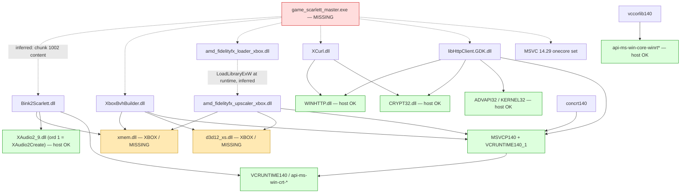

# Dependency Graph

Edges are static import-table entries from `data/pe.json` unless marked dashed (inferred). Dashed edges are MEDIUM/LOW.

## Resolution matrix

| Edge target | Status | Consumers |
|---|---|---|
| Windows API sets / system DLLs | resolved on host (HIGH) | all 16 |
| CRT/STL set | bundled in dump | all C++ DLLs |
| `xmem.dll` | **unresolved** | Bink2Scarlett (XMemAlloc, XMemFree), XboxBvhBuilder (XMemVirtualQuery), upscaler (XMemAlloc, XMemFree, XMemGetWorkingSetStatistics) |
| `d3d12_xs.dll` | **unresolved** | XboxBvhBuilder (D3D12SerializeVersionedRootSignature), upscaler (D3D12CreateRootSignatureDeserializer) |
| main exe | **absent** | root of the graph |

## Plain-text topological order (load-order leaves first)
1. API sets, KERNEL32 → 2. VCRUNTIME140 → 3. VCRUNTIME140_1, MSVCP140 → 4. msvcp140_{1,2,atomic_wait,codecvt_ids}, concrt140, vcomp140, vccorlib140 → 5. XCurl, libHttpClient.GDK, FFX loader (all loadable on Windows) → 6. **[blocked: xmem.dll, d3d12_xs.dll]** → 7. Bink2Scarlett, XboxBvhBuilder, FFX upscaler → 8. game exe (missing).

## Not in the graph (UNKNOWN)
Anything the exe itself imports; any dynamically loaded modules (`LoadLibrary*` strings) — the exe is absent and no DLL string scan for dynamic loads was performed beyond import tables.
